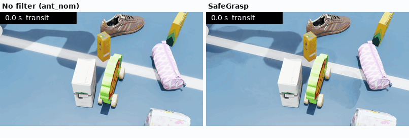
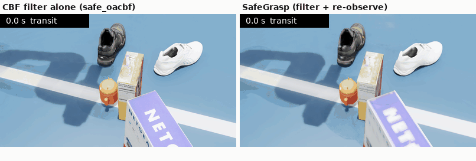

# SafeGrasp: Occlusion-Aware Safe Grasping in Clutter with Control Barrier Functions

EE6110 Special Topics in Automation and Control (Advanced), Segment C continuous assessment.

## Team

- Nuthasith Gerdpratoom (A0330412Y)
- Sithija Ranaraja (A0340088E)

## Demonstration video

https://youtu.be/EwMxesAZIOY

## Report

The project report is [`report.pdf`](report.pdf).

## What it does

A Franka Panda picks a given target object from a cluttered table in Isaac Sim. The objects are drawn at
random from Google Scanned Objects (1,025 models converted to USD). A single depth camera watches the
table, so some of the space behind the objects is hidden from it (their occlusion shadows).

SafeGrasp proposes antipodal grasps from the depth image and ranks them by how safely the arm can reach
them. The arm is then driven through a control barrier function (CBF) filter, a small quadratic program
that changes the joint velocities as little as possible while keeping the arm clear of obstacles. The
filter treats the hidden space as possibly occupied. When the arm stalls, the robot looks at the scene
again with two side cameras and carries on with the same grasp.

Both clips below come from Isaac Sim 5.1 and play at twice real speed.



In scene 407001, the unfiltered grasp presses a finger on an object behind the target and only lifts
the target on its third attempt. SafeGrasp touches nothing and lifts it on the first attempt.



In scene 408004, the filter alone stalls on the approach and never reaches the grasp. SafeGrasp stalls
at the same point, looks again with the side cameras and then completes the same grasp.

## Branches

| branch | Isaac Sim / Isaac Lab | experiments |
|---|---|---|
| `master` (this one) | 5.1 / 2.3.2 | main benchmark (1,792 trials), controller ablation (918), deadlock recovery (153 + 448) |
| `isaacsim_6.1` | 6.1 / 3.0 | later experiments on the grasp close and on Segment Anything masks for pick-and-place |

Rates cannot be compared across the two platforms, so each comparison is paired within one platform.

## Results on this branch

All methods ran on the same 224 scenes in Isaac Sim 5.1. A deadlock means that the arm stopped short of
the grasp because the filter blocked every way forward.

| method | success | collision | deadlock |
|---|---|---|---|
| `ant_nom`: antipodal grasp, no filter | 60% | 8% | 1% |
| `safe_oacbf`: safety ranking + occlusion-aware CBF | 32% | 1% | 26% |
| SafeGrasp (`safe_oacbf@recover=reobserve`) | 40% | 1% | 4% |

The SafeGrasp row comes from a separate batch on the same scenes, in which `safe_oacbf` reached 29%
success and 26% deadlock. The full tables, with 95% intervals and paired tests, are in
`results/summary_main.md`, `results/summary_abl.md`, `results/summary_dl.md` and
`results/summary_dl_main.md`. The two recovery experiments are written up in `results/ab_deadlock.md` and
`results/ab_deadlock_main.md`.

## Requirements

- Linux and an NVIDIA GPU (all our runs used one RTX 5080 with 16 GB).
- Isaac Sim 5.1 at `~/isaacsim` with Isaac Lab 2.3.2. The launcher calls `~/isaacsim/python.sh`, so if
  Isaac Sim is installed elsewhere, change `PY` in `scripts/launch_benchmark.py`.
- A few extra packages in Isaac Sim's Python (the versions we used):

```bash
~/isaacsim/python.sh -m pip install osqp==0.6.7.post3 qpsolvers==4.11.0 daqp==0.7.2 trimesh==4.5.1 scikit-learn imageio pytest
```

Only `safegrasp/sim/` and the scripts that start the simulator import Isaac, so the tests and the
analysis run without it.

## Object dataset (once)

```bash
git clone --depth 1 https://github.com/kevinzakka/mujoco_scanned_objects data/gso_raw
~/isaacsim/python.sh scripts/convert_gso.py --workers 16
```

This writes `data/gso_usd/`, `data/gso_points/` and `data/gso_catalog.json`, which are not in the
repository. Next, flag the objects that misbehave in simulation, in four batches of 260:

```bash
for i in 0 1 2 3; do ~/isaacsim/python.sh -u scripts/validate_gso_isaac.py --all --batch-index $i --log-file val_$i.log > val_$i.log 2>&1; done
```

Our own validation results are in `results/gso_validation/`.

## How to run

The unit tests are pure Python and take about 20 s:

```bash
~/isaacsim/python.sh -m pytest -q tests/
```

For a short run, the command below starts one Isaac Sim process and runs three methods on one scene per
clutter level. That makes 12 trials, which take about a minute once Isaac Sim has started. The rows are
written to `results/raw/demo/w00.jsonl`.

```bash
~/isaacsim/python.sh scripts/run_benchmark.py --exp demo --n-scenes 1 --methods ant_nom,safe_oacbf,safe_oacbf@recover=reobserve
```

The scripts below re-run the experiments in the report. Each one starts five Isaac Sim workers and
restarts any that crash. Run them one at a time.

```bash
scripts/bench_main.sh 20      # main benchmark: 8 methods, 4 clutter levels, 3 object pools
scripts/bench_ablation.sh     # controller ablation on dense and hidden scenes
scripts/bench_deadlock.sh     # deadlock recovery A/B on the ablation scenes
scripts/bench_dl_main.sh      # SafeGrasp against the filter alone on the main scenes
```

Workers append to `results/raw/<exp>/` and skip any trial that is already there. Our raw results are in
those folders, so move a folder elsewhere before re-running its experiment.

The analysis scripts rebuild the tables and figures from the raw results. Plain `python3` with numpy,
scipy and matplotlib is enough:

```bash
python3 scripts/analyze.py --exp main --exp abl
python3 scripts/analyze_dl.py
python3 scripts/analyze_dl_main.py
```

To film one scene and draw the qualitative figures (written to `results/film/` and `results/figures/`):

```bash
~/isaacsim/python.sh scripts/film_episodes.py --scene hidden:407000 --methods ant_nom,safe_oacbf
~/isaacsim/python.sh scripts/make_figures.py --seed 407000 --methods ant_nom,safe_oacbf
```

## Scripts behind each report table

| report item | branch | run | analyse | output |
|---|---|---|---|---|
| Table 1: SafeGrasp against baselines | `master` | `bench_main.sh 20`, `bench_dl_main.sh` | `analyze.py --exp main`, `analyze_dl_main.py` | `results/summary_main.md`, `results/summary_dl_main.md` |
| Table 2 and the outcome figure: main benchmark | `master` | `bench_main.sh 20` | `analyze.py --exp main` | `results/summary_main.md`, `results/figures/main_outcomes.png` |
| Table 3: controller ablation | `master` | `bench_ablation.sh` | `analyze.py --exp abl` | `results/summary_abl.md` |
| Table 4: deadlock recovery | `master` | `bench_deadlock.sh` | `analyze_dl.py` | `results/summary_dl.md`, `results/figures/dl_outcomes.png` |
| Perception and CBF trace plots of scene 407000 (PNG versions of the report figures) | `master` | `film_episodes.py` | `make_figures.py` | `results/figures/` |
| Table 5 (interventions on the close) and the SAM figure | `isaacsim_6.1` | see that branch's README | | |

## Method names

Each method is named `{proposer}_{executor}`, with optional settings after `@`.

| part | options |
|---|---|
| proposer | `td`: top-down grasp from the object's principal axes; `ant`: antipodal grasps; `safe`: antipodal grasps ranked by the arm's clearance along the path |
| executor | `nom`: no avoidance; `apf`: potential field; `cbf`: CBF on observed obstacles; `oacbf`: CBF on observed obstacles and hidden space |
| settings | e.g. `@recover=reobserve`, `@views=main+left+right`, `@alpha=2`, `@margin_unk=0.0`, `@noise=3` (see `safegrasp/pipeline/methods.py`) |

## Layout

| path | contents |
|---|---|
| `safegrasp/sim/` | Isaac Lab scene (robot, three fixed cameras, pooled objects, contacts) and seeded scene generators |
| `safegrasp/perception/` | depth noise, back-projection, voxel map (free, occupied, unknown), occlusion shadows, distance fields |
| `safegrasp/kinematics/` | Panda forward and inverse kinematics matched to Isaac, 55 collision spheres |
| `safegrasp/grasping/` | gripper geometry, top-down and antipodal proposers, safety-aware ranking |
| `safegrasp/control/` | nominal resolved-rate control, CBF-QP safety filter, potential-field baseline |
| `safegrasp/pipeline/` | method registry, per-trial pipeline (perceive, propose, execute, evaluate), deadlock recovery |
| `scripts/` | benchmark worker and launcher, analysis, figures, dataset conversion, kinematics checks against Isaac |
| `tests/` | unit tests (no Isaac needed) |
| `results/` | summaries, raw trial rows (`raw/*/w*.jsonl`), worker logs and figures |
| `media/` | the two GIFs in this README |
| `report.pdf` | the project report |

The kinematics data in `safegrasp/kinematics/` came from `scripts/verify_fk_isaac.py`,
`scripts/fit_panda_spheres.py` and `scripts/measure_gripper_geometry.py`. They do not need to be run
again.
